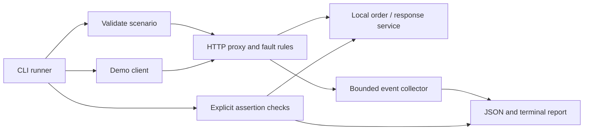

# Architecture and technology

[Documentation index](README.md)

## Architecture



Initially, run one scenario at a time. The runner owns setup, readiness checks, execution, reporting, and shutdown. The demo service binds to a separate local port. Its state is reset between scenarios.

Use one repository and a few modules. You do not need a distributed system, job queue, or monorepo tooling.

## Technology stack

| Component           | Choice                               | Why                                                 |
| ------------------- | ------------------------------------ | --------------------------------------------------- |
| Language            | TypeScript, strict mode, ESM         | Build on your existing ability                      |
| Runtime             | A supported Node.js LTS release      | Stable baseline; use its matching documentation     |
| Proxy               | Built-in `node:http`                 | Learn request and response lifecycles directly      |
| Tests               | `node:test` and `node:assert/strict` | Enough for this project's integration tests         |
| Runtime validation  | Zod                                  | Scenario files are untrusted input despite TS types |
| Initial persistence | Scenario files and JSON reports      | Finish the core before adding a database            |
| Optional interface  | React report viewer                  | Makes demonstrations easier after the CLI works     |

Compile TypeScript with `tsc` and execute compiled JavaScript. Keep setup conventional; do not spend days comparing frameworks. Use `type` aliases, avoid `any`, and narrow `unknown` input.

## Suggested repository structure

```text
api-resilience-runner/
  docs/
  src/
    proxy.ts
    scenario.ts
    runner.ts
    report.ts
    lifecycle.ts
    cli.ts
  demo/
    service.ts
    main.ts
    client.ts
  scenarios/
    lost-response.json
    rate-limit.json
    truncated-response.json
  test/
  README.md
```

Split further only when a module becomes difficult to understand. Do not create plugin frameworks or a generic workflow engine for three scenarios.

Fault application lives in `proxy.ts`; the small set of rules does not need a separate dispatch layer. `client.ts` exposes flawed and corrected modes with shared request plumbing. `lifecycle.ts` binds temporary loopback ports and closes servers. Each run creates fresh service state.

See [requirements and scope](requirements.md) for first-version boundaries.
